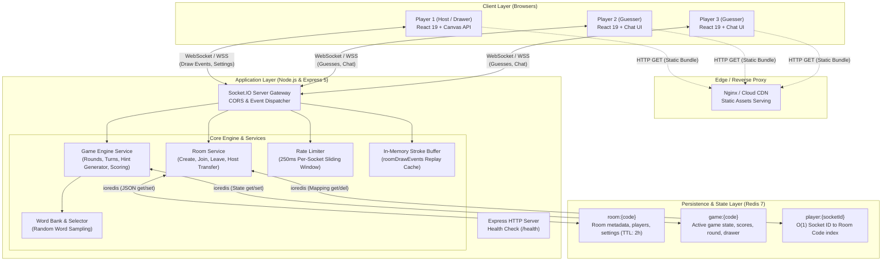
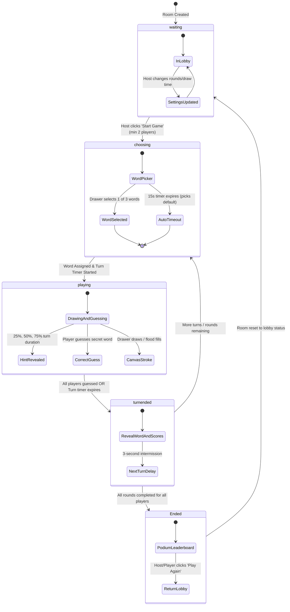
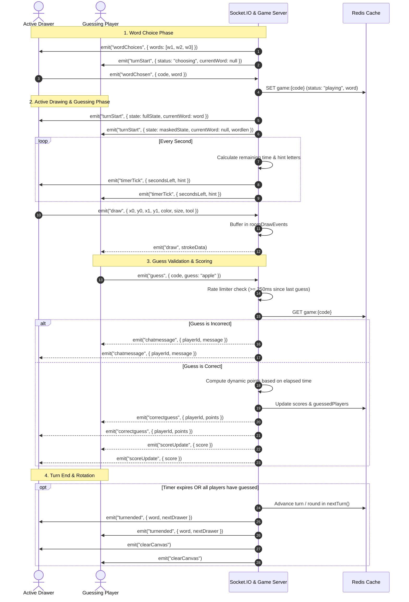

# 🎨 Skribl — Real-Time Multiplayer Drawing & Guessing Game

A full-stack, real-time multiplayer drawing and guessing game inspired by Skribbl.io. Built with **React 19**, **Vite**, **TypeScript**, **Node.js**, **Express 5**, **Socket.IO**, and **Redis**.

---

## ✨ Features

- **Multiplayer Room System**:
  - Create private game rooms with unique 6-character room codes.
  - Join rooms with custom nicknames and avatar badges.
  - Host room controls: configure draw time, rounds, and max players.
  - Automatic host reassignment if the current host disconnects.
  - Mid-game session reconnection support (`rejoinRoom`) preserving scores and game state.
- **Interactive Game Flow**:
  - **State Machine**: `waiting` (lobby) → `choosing` (word pick) → `playing` (drawing/guessing) → `Ended` (podium).
  - **Word Selection**: The active drawer chooses 1 of 3 random words (with a 15-second countdown / auto-pick fallback).
  - **Progressive Hint System**: Letter hints reveal dynamically at 25%, 50%, and 75% of the elapsed turn time without exposing hidden characters prematurely.
  - **Dynamic Scoring System**: Earlier correct guesses yield higher points (up to 500 points); drawer earns bonus points per successful guess.
  - **Turn Rotation & End-Game**: Automatic turn switching, round tracking, and top-3 podium leaderboard.
- **HTML5 Canvas Drawing Suite**:
  - Synchronized real-time drawing with sub-millisecond socket broadcasts.
  - Multiple tools: **Pencil**, **Eraser**, and **Fill Bucket** (flood-fill algorithm on raw canvas pixel buffers).
  - Adjustable brush sizes and curated color palette with custom color picker.
  - Replay buffer so newly joined or rejoining players receive previously drawn strokes.
- **Real-Time Chat & Guessing**:
  - Integrated chat box that automatically distinguishes regular chat from correct guesses.
  - Anti-cheat role masking: the secret word is sanitized (`null`) on the server before dispatching to non-drawing clients.
  - Color-coded notifications for correct guesses, system updates, and turn results.
  - Rate-limiting protection against guess/chat spam (250ms sliding window per socket).
- **Modern UI & Aesthetic**:
  - Dark mode glassmorphism interface styled with vanilla CSS custom properties.
  - Smooth animations, Google Fonts (`Inter` and `Outfit`), and responsive layout.

---

## 🛠️ Tech Stack

| Layer | Technologies | Purpose |
|---|---|---|
| **Frontend** | React 19, TypeScript, Vite, HTML5 Canvas API | Reactive UI, client-side game store, hardware-accelerated canvas rendering |
| **Backend** | Node.js, Express 5, TypeScript, Socket.IO Server | Real-time event gateway, HTTP health checks, game loop orchestration |
| **Storage & State** | Redis 7 (ioredis) | In-memory room metadata, session mapping, game state, auto-TTL cleanup |
| **Shared Contracts** | TypeScript Monorepo (`packages/types`) | Strictly typed client-server socket events and shared domain entities |
| **Containers & Deploy** | Docker, Docker Compose, Render Blueprint | Containerized microservices, multi-stage Nginx builds, cloud deployment |

---

## 🏛️ System Architecture & System Design

### 1. High-Level System Architecture

The application adopts an event-driven, client-server architecture utilizing **Socket.IO** over WebSockets for bi-directional communication, with an in-memory **Redis** cluster/instance for state persistence.



---

### 2. Game State Machine

The game engine operates on a deterministic finite state machine managed on the server and synchronized to clients:



---

### 3. Real-Time Data Flow & Turn Lifecycle

Below is the sequence of events during a round, from word selection to drawing, guessing, and scoring:



---

### 4. Redis Key Schema & Data Models

| Key Pattern | Redis Type | TTL | Description |
|---|---|---|---|
| `room:{code}` | String (JSON) | 7200s (2 hrs) | Stores room configuration: `hostId`, `status`, `players` list, and `settings` (`drawtime`, `rounds`, `maxmembers`). |
| `game:{code}` | String (JSON) | Matches room session | Active game session: `currentRound`, `currentPlayerID`, `turnEndTime`, `status`, `currentWord`, `score` map, and `guessedPlayers` list. |
| `player:{socketId}` | String | Matches socket lifetime | Inverted index mapping active socket connection IDs to room codes. Enables $O(1)$ cleanup on disconnect. |

#### Ephemeral Server In-Memory State:
- `roomDrawEvents`: `Map<roomCode, DrawEvent[]>` — Stores stroke history (capped at 2500 events) for replaying canvas history to late/reconnecting clients.
- `activeTimers`: `Map<roomCode, NodeJS.Timeout>` — Turn-end countdown timeouts.
- `tickIntervals`: `Map<roomCode, NodeJS.Timeout>` — 1-second interval emitters for timers and progressive hints.
- `chooseTimers`: `Map<roomCode, NodeJS.Timeout>` — 15-second timeouts for drawer word selection.
- `lastGuessTime`: `Map<socketId, number>` — Timestamp tracking to enforce 250ms anti-spam guess rate limits.

---

### 5. Architectural & Implementation Highlights

1. **Anti-Cheat Word Masking**:
   - The actual `currentWord` is stripped (`null`) before being transmitted across the network to any player who is not the active drawer.
   - Guess validation executes exclusively on the server with case-insensitive whitespace trimming.
2. **Dynamic Turn-Based Scoring Formula**:
   - Guessers receive points proportional to remaining time:
     $$\text{points} = 100 + \left\lfloor \frac{\text{timeLeftMs}}{\text{totalTimeMs}} \times 400 \right\rfloor$$
     *(Guarantees between 100 and 500 points for correct guesses).*
   - The drawer receives 50 bonus points per correct guess made by other players.
3. **Progressive Hint Revelation**:
   - Generates masked strings (`_ _ _ _ _`).
   - Dynamically reveals letters at 25%, 50%, and 75% of the elapsed turn duration while preserving whitespace and punctuation.
4. **Flood Fill Algorithm**:
   - Implemented directly on the client using HTML5 Canvas raw `ImageData` pixel buffers (`CanvasRenderingContext2D.getImageData`).
   - Uses an iterative queue-based flood-fill to prevent recursion stack overflow on large surfaces.
5. **Mid-Game Reconnection Handling**:
   - If a client refreshes their tab, `rejoinRoom` binds the new socket ID to their previous player profile in Redis, restores current scores, and emits the active game state and stroke replay history.
6. **Graceful Host Failover**:
   - If the room host disconnects, the server automatically transfers host privileges to the next available player in the room.

---

## 📁 Repository Structure

```text
skribl/
├── client/                     # Frontend React 19 + Vite application
│   ├── src/
│   │   ├── app/                # Root App component and screen router
│   │   ├── components/
│   │   │   ├── game/           # In-game interactive components
│   │   │   │   ├── Canvas.tsx          # Canvas element, mouse/touch event listeners
│   │   │   │   ├── CanvasToolbar.tsx   # Color palette, brush size, pencil/eraser/fill tools
│   │   │   │   ├── ChatBox.tsx         # Real-time chat & guess log
│   │   │   │   ├── PlayerList.tsx      # Sidebar player leaderboard & turn indicators
│   │   │   │   ├── TimerBar.tsx        # Dynamic color-coded countdown bar
│   │   │   │   ├── WordChooser.tsx     # 3-word selection modal for drawer
│   │   │   │   └── WordDisplay.tsx     # Hidden/revealed word hint banner
│   │   │   └── screens/        # Main application screens
│   │   │       ├── HomeScreen.tsx      # Landing page: Create or Join room
│   │   │       ├── LobbyScreen.tsx     # Pre-game lobby & host settings panel
│   │   │       ├── GameScreen.tsx      # Main 3-column gameplay layout
│   │   │       └── EndScreen.tsx       # Post-game podium & final rankings
│   │   ├── context/            # React context & state store
│   │   ├── hooks/              # Custom socket event subscriptions (useSocketEvents)
│   │   ├── services/           # Socket.IO client instance singleton
│   │   └── index.css           # Global design tokens, dark glassmorphism styling
│   ├── Dockerfile              # Multi-stage production build (Vite -> Nginx)
│   └── package.json
├── server/                     # Backend Node.js + Express + Socket.IO server
│   ├── src/
│   │   ├── services/
│   │   │   ├── roomService.ts  # Room lifecycle, host election, player management
│   │   │   └── gameService.ts  # Turn rotation, word banks, scoring, progressive hints
│   │   ├── redis.ts            # ioredis client with URL/TLS parsing & reconnect logic
│   │   ├── server.ts           # Socket.IO event handlers, timer loops, Express API
│   │   └── types/              # Server-specific types
│   ├── Dockerfile              # Multi-stage production container build
│   └── package.json
├── packages/
│   └── types/                  # Shared TypeScript interfaces & socket event contracts
│       └── src/index.ts        # Player, Room, GameState, Client/Server event maps
├── docker-compose.yml          # Container orchestration for Redis, server, and client
├── render.yaml                 # Infrastructure-as-code for Render cloud deployment
├── Progress.md                 # Detailed phase roadmap & session changelogs
└── package.json                # Monorepo root configuration (npm workspaces)
```

---

## 🚀 Getting Started

### Prerequisites

Ensure you have the following installed on your machine:
- [Node.js](https://nodejs.org/) (v18 or higher; v20+ recommended)
- [Docker](https://www.docker.com/) & Docker Compose (for running Redis or containerized app)

---

### Method 1: Local Development (Recommended)

1. **Clone the repository and install dependencies:**
   ```bash
   git clone https://github.com/SarveshMS7/skribl.git
   cd skribl
   npm install
   ```

2. **Start the Redis container:**
   ```bash
   docker compose up -d redis
   ```
   > Redis will be accessible on `localhost:6379`.

3. **Start the backend server:**
   ```bash
   npm run dev --workspace=server
   ```
   > Server will start on `http://localhost:3001`.

4. **Start the frontend client:**
   ```bash
   npm run dev --workspace=client
   ```
   > Client will start on `http://localhost:5173`.

5. **Open the game:**
   Navigate to [`http://localhost:5173`](http://localhost:5173) in your browser. Open multiple browser tabs or incognito windows to test multiplayer functionality.

---

### Method 2: Running with Docker Compose (Full Stack)

To build and run all services (Redis, Server, and Client with Nginx) in Docker containers:

```bash
docker compose up --build
```

- **Frontend Client**: [`http://localhost:80`](http://localhost:80)
- **Backend Server**: [`http://localhost:3001`](http://localhost:3001)
- **Redis**: Port `6379`

To stop containers:
```bash
docker compose down
```

---

## ☁️ Cloud Deployment (Render Blueprint)

The repository includes a ready-to-use [`render.yaml`](render.yaml) blueprint specification for zero-config deployment on Render.

1. Create a Redis instance on [Upstash](https://upstash.com/) or Render.
2. Link your GitHub repository on Render and create a new **Blueprint**.
3. Render automatically provisions:
   - **`skribl-server`**: Node.js Web Service running `npm run start:server` with health check at `/health`.
   - **`skribl-client`**: Static Site publishing `client/dist` with SPA rewrite rules (`/*` → `/index.html`).
4. Set the environment variables:
   - In `skribl-server`: Set `REDIS_URL` to your Redis connection string (e.g. `rediss://...`), and set `CLIENT_ORIGIN` to your client URL.
   - In `skribl-client`: Set `VITE_SERVER_URL` to your deployed backend URL.

---

## ⚙️ Environment Variables

### Backend (`server/.env`)

| Variable | Default | Description |
|---|---|---|
| `PORT` | `3001` | Port the HTTP and Socket.IO server listens on |
| `REDIS_URL` | *None* | Connection URL for Redis (supports `redis://` or `rediss://` for cloud providers like Upstash/Render) |
| `REDIS_HOST` | `localhost` | Hostname for Redis (used if `REDIS_URL` is omitted) |
| `REDIS_PORT` | `6379` | Port for Redis connection (used if `REDIS_URL` is omitted) |
| `REDIS_PASSWORD` | *None* | Authentication password for Redis |
| `CLIENT_ORIGIN`| `http://localhost:5173` | Allowed CORS origins (comma-separated list, e.g. `https://skribl.onrender.com,http://localhost:5173` or `*`) |

### Frontend (`client/.env`)

| Variable | Default | Description |
|---|---|---|
| `VITE_SERVER_URL` | `http://localhost:3001` | URL of the backend Socket.IO server |

---

## 📜 Available NPM Scripts

Run from the root directory:

| Command | Description |
|---|---|
| `npm run dev --workspace=server` | Runs backend in development mode with `nodemon` and `ts-node` |
| `npm run dev --workspace=client` | Runs frontend Vite dev server with Hot Module Replacement |
| `npm run build:client` | Compiles TypeScript and builds production client bundle to `client/dist` |
| `npm run build:server` | Compiles backend TypeScript to `server/dist` |
| `npm run build` | Builds both client and server projects |
| `npm run start:server` | Runs the compiled production backend server (`node dist/server.js`) |

---

## 🔌 Socket.IO Event Reference

The app enforces strictly typed Socket.IO contracts defined in [`packages/types`](packages/types/src/index.ts):

### Client to Server Events (`ClientToServerEvents`)

| Event Name | Payload | Description |
|---|---|---|
| `createRoom` | `{ name: string }` | Request creation of a new room with host player name |
| `joinRoom` | `{ name: string, code: string }` | Join an existing room using a 6-character room code |
| `rejoinRoom` | `{ name: string, code: string }` | Re-attach an active player session after page refresh |
| `gameSettings`| `{ code: string, settings: Partial<GameSettings> }` | Update round count, draw time, or player limits (host only) |
| `startGame` | `{ code: string }` | Initiate game transition from lobby to active match (host only) |
| `wordChosen` | `{ code: string, word: string }` | Active drawer picks 1 of the 3 provided word options |
| `draw` | `DrawEvent` | Stream stroke coordinates (`x0, y0, x1, y1`), color, size, and tool |
| `clearboard` | `{ code: string }` | Drawer wipes the canvas |
| `guess` | `{ code: string, guess: string }` | Player submits a guess or chat text (rate-limited to 250ms) |
| `playAgain` | `{ code: string }` | Return all room members from final podium back to lobby |

### Server to Client Events (`ServerToClientEvents`)

| Event Name | Payload | Description |
|---|---|---|
| `roomCreated` | `{ code: string }` | Confirms room creation and delivers room code to host |
| `roomUpdated` | `Room` | Emits updated room state, settings, and player roster to all room members |
| `gamestarted` | `{ state: GameState }` | Signals game commencement to all players |
| `wordChoices` | `{ words: string[] }` | Delivers 3 random word choices exclusively to active drawer |
| `turnStart` | `{ state: GameState, wordlen?: number }` | Signals start of turn with drawer ID and sanitized word/length |
| `timerTick` | `{ secondsLeft: number, hint: string }` | Broadcasts remaining seconds and progressive letter hints every second |
| `draw` | `DrawEvent` | Broadcasts incoming drawing strokes to all non-drawing players |
| `clearCanvas` | *(None)* | Instructs clients to wipe their canvas display |
| `correctguess`| `{ playerId: string, points: number }` | Announces that a player guessed correctly with awarded points |
| `chatmessage` | `{ playerId: string, message: string }` | Relays non-matching chat messages to room |
| `scoreUpdate` | `{ score: Record<string, number> }` | Broadcasts real-time updated scoreboard |
| `turnended` | `{ reason: string, nextDrawer: string, word: string }` | Concludes turn, reveals secret word, and announces next drawer |
| `gameEnded` | `{ state: GameState }` | Emits final scores and triggers podium screen |
| `returnedToLobby` | `{ room: Room }` | Resets client screens back to lobby state |
| `error` | `{ message: string }` | Notifies client of permission, validation, or room errors |

---

## 📄 License

This project is open-source under the [ISC License](LICENSE).
